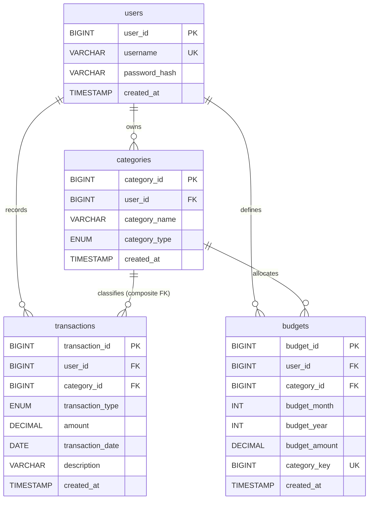

# SpendWise: Your money. Your clarity.

A complete, database-backed personal finance management desktop workstation built for a second-year AIML engineering college project.

**Tagline**: *Your money. Your clarity.*  
**Stack**: Java 21 LTS, Java Swing, JDBC, MySQL 8, Maven, JUnit 5, FlatLaf, JFreeChart, Git.

---

## 1. Architecture & Design Principles

SpendWise follows a strict three-tier layered architecture with clean separation of concerns:
- **Presentation Layer (`com.spendwise.ui`)**: Pure Java Swing with FlatLaf dark fintech look, Java2D vector-drawn icons, non-blocking asynchronous database operations via `SwingWorker`, and zero hardcoded demo data.
- **Service Layer (`com.spendwise.service`)**: Strict input validation, explainable rule-based analytical intelligence (unusual spending spike detection, leap-year-aware forecasting, non-persistent what-if simulation), and custom domain exceptions.
- **Data Access Layer (`com.spendwise.repository`, `com.spendwise.database`)**: Parameterized JDBC `PreparedStatement` queries, push-down SQL aggregations (`SUM`, `AVG`, `GROUP BY`, `HAVING`, `JOIN`), and complete prevention of SQL injection.

```text
spendwise/
├── pom.xml
├── README.md
├── DEMO_SCRIPT.md
├── VIVA_GUIDE.md
├── database/
│   ├── schema.sql
│   └── sample_data.sql
└── src/
    ├── main/
    │   ├── java/com/spendwise/
    │   │   ├── Main.java
    │   │   ├── database/
    │   │   │   └── DatabaseConnection.java
    │   │   ├── model/
    │   │   │   ├── Budget.java
    │   │   │   ├── BudgetStatus.java
    │   │   │   ├── Category.java
    │   │   │   ├── CategorySpending.java
    │   │   │   ├── CategoryType.java
    │   │   │   ├── MonthComparison.java
    │   │   │   ├── MonthlySummary.java
    │   │   │   ├── SimulatorResult.java
    │   │   │   ├── SpendingForecast.java
    │   │   │   ├── Transaction.java
    │   │   │   ├── TransactionType.java
    │   │   │   ├── UnusualSpendingInsight.java
    │   │   │   └── User.java
    │   │   ├── repository/
    │   │   │   ├── BudgetRepository.java
    │   │   │   ├── CategoryRepository.java
    │   │   │   ├── JdbcBudgetRepository.java
    │   │   │   ├── JdbcCategoryRepository.java
    │   │   │   ├── JdbcReportRepository.java
    │   │   │   ├── JdbcTransactionRepository.java
    │   │   │   ├── ReportRepository.java
    │   │   │   └── TransactionRepository.java
    │   │   ├── service/
    │   │   │   ├── BudgetService.java
    │   │   │   ├── CategoryService.java
    │   │   │   ├── DataAccessException.java
    │   │   │   ├── ReportService.java
    │   │   │   ├── SpendingAnalysisService.java
    │   │   │   ├── TransactionService.java
    │   │   │   └── ValidationException.java
    │   │   ├── ui/
    │   │   │   ├── MainFrame.java
    │   │   │   ├── components/
    │   │   │   │   ├── AsyncWorker.java
    │   │   │   │   ├── ChartPanel.java
    │   │   │   │   ├── ConfirmationDialog.java
    │   │   │   │   ├── EmptyStatePanel.java
    │   │   │   │   ├── LoadingPanel.java
    │   │   │   │   ├── ProgressIndicator.java
    │   │   │   │   ├── SectionHeader.java
    │   │   │   │   ├── StyledButton.java
    │   │   │   │   ├── StyledComboBox.java
    │   │   │   │   ├── StyledTable.java
    │   │   │   │   ├── StyledTextField.java
    │   │   │   │   ├── SummaryCard.java
    │   │   │   │   └── Toast.java
    │   │   │   ├── screens/
    │   │   │   │   ├── BaseScreen.java
    │   │   │   │   ├── BudgetsScreen.java
    │   │   │   │   ├── CategoriesScreen.java
    │   │   │   │   ├── DashboardScreen.java
    │   │   │   │   ├── ReportsScreen.java
    │   │   │   │   ├── SettingsScreen.java
    │   │   │   │   └── WelcomeScreen.java
    │   │   │   └── theme/
    │   │   │       ├── AppIcons.java
    │   │   │       └── AppTheme.java
    │   │   └── util/
    │   │       └── MoneyUtil.java
    │   └── resources/
    │       ├── application.properties.example
    │       └── application.properties (gitignored)
    └── test/
        ├── java/com/spendwise/
        │   ├── database/DatabaseConnectionTest.java
        │   ├── repository/RepositoryIntegrationTest.java
        │   ├── service/
        │   │   ├── ServiceUnitTest.java
        │   │   └── fakes/
        │   └── util/MoneyUtilTest.java
        └── resources/
            └── application.properties (gitignored)
```

---

## 2. Entity-Relationship (ER) Diagram



---

## 3. Class Diagram

```mermaid
classDiagram
    class MoneyUtil {
        +zero() BigDecimal
        +of(BigDecimal) BigDecimal
        +of(double) BigDecimal
        +parse(String) BigDecimal
        +formatRupees(BigDecimal) String
    }

    class DatabaseConnection {
        +getConnection() Connection
        +checkConnectivity() boolean
        +setTestMode(boolean)
    }

    class CategoryRepository {
        <<interface>>
        +findById(Long) Optional~Category~
        +findByUserId(Long) List~Category~
        +save(Category) Category
        +deleteById(Long) boolean
        +countTransactions(Long) int
    }

    class TransactionRepository {
        <<interface>>
        +findById(Long) Optional~Transaction~
        +findFiltered(...) List~Transaction~
        +save(Transaction) Transaction
        +deleteById(Long) boolean
    }

    class BudgetRepository {
        <<interface>>
        +findOverallBudget(Long, int, int) Optional~Budget~
        +findCategoryBudget(Long, Long, int, int) Optional~Budget~
        +save(Budget) Budget
        +deleteById(Long) boolean
    }

    class ReportRepository {
        <<interface>>
        +getMonthlySummary(Long, int, int) MonthlySummary
        +getCategorySpending(Long, int, int, CategoryType) List~CategorySpending~
        +getMonthlyHistory(Long, int, LocalDate) List~MonthComparison~
        +getBudgetStatuses(Long, int, int) List~BudgetStatus~
        +getOverallBudgetStatus(Long, int, int) Optional~BudgetStatus~
    }

    class CategoryService {
        -CategoryRepository categoryRepo
        +createCategory(...) Category
        +updateCategory(...) boolean
        +deleteCategory(Long) boolean
    }

    class TransactionService {
        -TransactionRepository txRepo
        -CategoryRepository categoryRepo
        +addTransaction(...) Transaction
        +updateTransaction(...) boolean
        +deleteTransaction(Long) boolean
    }

    class BudgetService {
        -BudgetRepository budgetRepo
        -CategoryRepository categoryRepo
        +setOverallBudget(...) Budget
        +setCategoryBudget(...) Budget
        +deleteBudget(Long) boolean
    }

    class ReportService {
        -ReportRepository reportRepo
        +getMonthlySummary(...) MonthlySummary
        +getCategorySpending(...) List~CategorySpending~
        +getCategoryBudgetStatuses(...) List~BudgetStatus~
    }

    class SpendingAnalysisService {
        -ReportRepository reportRepo
        -CategoryRepository categoryRepo
        +detectUnusualSpending(...) List~UnusualSpendingInsight~
        +forecastMonthlySpending(...) SpendingForecast
        +simulateSavings(...) SimulatorResult
    }

    CategoryService --> CategoryRepository
    TransactionService --> TransactionRepository
    TransactionService --> CategoryRepository
    BudgetService --> BudgetRepository
    BudgetService --> CategoryRepository
    ReportService --> ReportRepository
    SpendingAnalysisService --> ReportRepository
    SpendingAnalysisService --> CategoryRepository
```



---

## 4. Database Design Decisions

- **Single Local User & Relational Integrity**: A `users` table holds the default local user (`user_id = 1`). Every entity retains `user_id` so ownership checks and ER relationships remain normalized.
- **Composite Type Integrity**: `categories` enforces `UNIQUE(category_id, category_type)`. The `transactions` table references `categories` via a composite foreign key `(category_id, transaction_type) REFERENCES categories(category_id, category_type)`. This guarantees that an EXPENSE transaction can never be linked to an INCOME category.
- **Delete Policy (`ON DELETE RESTRICT`)**: Categories referenced by transactions cannot be deleted, preserving financial audit trails.
- **Budget Uniqueness with NULLs**: Standard SQL allows multiple `NULL` values in unique indexes. To guarantee exactly one overall monthly budget (`category_id = NULL`), a stored generated column `category_key = IFNULL(category_id, 0)` is indexed under `UNIQUE(user_id, budget_year, budget_month, category_key)`.
- **Monetary Precision**: All currency operations use MySQL `DECIMAL(12,2)` and Java `BigDecimal` with scale 2 and `RoundingMode.HALF_UP`, centralized in `MoneyUtil`. Indian rupee formatting applies lakh grouping (e.g. `Rs 1,23,456.00`).

---

## 5. Feature Verification Checklist

All features have been implemented, tested, and verified:

- [x] Java 21, Swing, JDBC, MySQL 8, Maven architecture with zero external web frameworks
- [x] Database schema with composite foreign keys, CHECK constraints, and generated columns
- [x] Realistic 4-month sample data (July 2026 – October 2026) with Indian financial context
- [x] Repositories using parameterized `PreparedStatement` only and push-down SQL aggregations
- [x] Services with domain validation, custom exception hierarchy, and business logic
- [x] Explainable rule-based unusual spending detection (baseline over same elapsed-day window)
- [x] Month-end forecast with real calendar day counts and leap-year support
- [x] Pure What-If Spending Simulator that never mutates the database
- [x] FlatLaf dark fintech look and feel with Java2D vector-drawn icons (no emojis)
- [x] Responsive GUI with database operations off the EDT via `SwingWorker`
- [x] Full-window WelcomeScreen with custom brandmark and accessible toggle
- [x] Interactive Dashboard with 4 KPI cards, JFreeChart pie/bar charts, and recent ledger table
- [x] Transactions ledger with search, multi-field filters, and add/edit modals with validation
- [x] Categories screen with tabbed view, live counts, and deletion blocking
- [x] Budgets screen with overall cap card, category progress bars, and status labels
- [x] Reports screen with summary cards, breakdown table, and CSV export via file chooser
- [x] Settings screen with live database health check, animation toggle, and threshold editors
- [x] Complete isolation of database credentials from git tracking

---

## 6. Test Suite & Real Execution Results

```text
[INFO] -------------------------------------------------------
[INFO]  T E S T S
[INFO] -------------------------------------------------------
[INFO] Running com.spendwise.database.DatabaseConnectionTest
[INFO] Tests run: 2, Failures: 0, Errors: 0, Skipped: 0, Time elapsed: 0.322 s -- in com.spendwise.database.DatabaseConnectionTest
[INFO] Running com.spendwise.repository.RepositoryIntegrationTest
[INFO] Tests run: 4, Failures: 0, Errors: 0, Skipped: 0, Time elapsed: 0.262 s -- in com.spendwise.repository.RepositoryIntegrationTest
[INFO] Running com.spendwise.util.MoneyUtilTest
[INFO] Tests run: 5, Failures: 0, Errors: 0, Skipped: 0, Time elapsed: 0.015 s -- in com.spendwise.util.MoneyUtilTest
[INFO] Running com.spendwise.service.ServiceUnitTest
[INFO] Tests run: 10, Failures: 0, Errors: 0, Skipped: 0, Time elapsed: 0.062 s -- in com.spendwise.service.ServiceUnitTest
[INFO] 
[INFO] Results:
[INFO] Tests run: 21, Failures: 0, Errors: 0, Skipped: 0
[INFO] BUILD SUCCESS
```

| Test Class | Scope | Tests Run | Result | Key Verified Behaviors |
| :--- | :--- | :--- | :--- | :--- |
| `DatabaseConnectionTest` | Integration | 2 | **Passed** | Live JDBC connection, connectivity validity check |
| `RepositoryIntegrationTest` | Integration | 4 | **Passed** | Real CRUD against MySQL (`spendwise_test`), composite constraints, SQL aggregations |
| `MoneyUtilTest` | Unit | 5 | **Passed** | Scale 2, `HALF_UP` rounding, string parsing, Indian lakh formatting |
| `ServiceUnitTest` | Unit | 10 | **Passed** | Business validations, unusual spending baseline, leap-year forecast, simulator isolation, connection failure wrapping |

---

## 7. How to Setup and Run

### Step 1: Database Setup
Ensure MySQL 8 is running and initialize the database and user:
```bash
mysql -u root -p < database/schema.sql
mysql -u root -p < database/sample_data.sql
```

### Step 2: Configure Credentials
Create `src/main/resources/application.properties` (or edit existing):
```properties
db.url=jdbc:mysql://localhost:3306/spendwise?useSSL=false&allowPublicKeyRetrieval=true&serverTimezone=UTC
db.user=spendwise_app
db.password=YOUR_PASSWORD
```

### Step 3: Compile and Test
```bash
mvn clean test
```

### Step 4: Run Application
```bash
mvn exec:java
```
Or package and launch the standalone JAR:
```bash
mvn clean package
java -jar target/spendwise-1.0.0.jar
```

---

## 8. Presentation Resources

- **Demo Script**: See [DEMO_SCRIPT.md](file:///Users/ashif/.gemini/antigravity/scratch/spendwise/DEMO_SCRIPT.md) for the complete 8-minute presentation script divided between both team members.
- **Viva Preparation**: See [VIVA_GUIDE.md](file:///Users/ashif/.gemini/antigravity/scratch/spendwise/VIVA_GUIDE.md) for 40 detailed viva questions and answers, OOP table, and DBMS query mapping.
